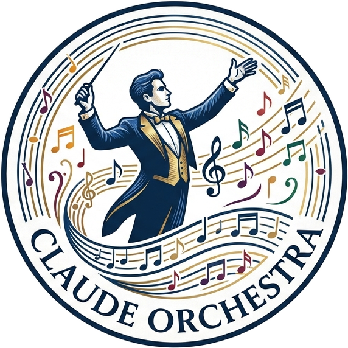

<p align="center">
  
</p>

# Claude Orchestra

**Add some music to your Claude session, and turn your multi-agent workflows into an orchestra.**

Claude works quietly. With this mod you can *hear* it as Claude thinks, writes and runs tools: a soft tick, a room full of busy people, or a full orchestra.

## Install

At the prompt of a Claude Code session in your terminal:

```
/plugin install orchestra --marketplace hari90/claude_orchestra
```

Answer `y` to add the marketplace, then pick a scope (user scope plays in every session). That's it: send a prompt and listen.

Requires macOS (sound plays through the built-in `afplay`). On Linux and Windows the mod loads but stays silent.

## What you'll hear

Each sound pack has a sound for four moments:

- **Writing**: while Claude types out a reply.
- **Thinking**: softer, while Claude thinks.
- **A tool call**: an accent each time Claude runs a tool.
- **Done**: a closing sound when Claude finishes your turn.

Nothing plays while Claude is idle or waiting on you. Every session plays on its own, so parallel sessions layer on top of each other.

## Pick your sound

Run `/config`, find **orchestra → Sound pack**, and choose:

| Pack | Sounds like |
|---|---|
| **Busy Dev** (default) | A laptop keyboard: soft, quick taps |
| **Newsroom** | A manual typewriter, with a carriage return and a bell |
| **In the Zone** | A clicky mechanical keyboard |
| **Lounge** | A solo piano |
| **Vienna** | A live orchestra |
| **Tick** | A single soft tick |
| **None** | Silence |

The packs are cut from real recordings shared on [Freesound](https://freesound.org/); see [the credits](sounds/CREDITS.md).

## More

- [Contributing](CONTRIBUTING.md): run your own copy, check it and send changes.
- [How it works](docs/how-it-works.md): the hooks and the sounds.
- [AGENTS.md](AGENTS.md): notes for AI agents working in this repo.

## License

[Apache 2.0](LICENSE)
